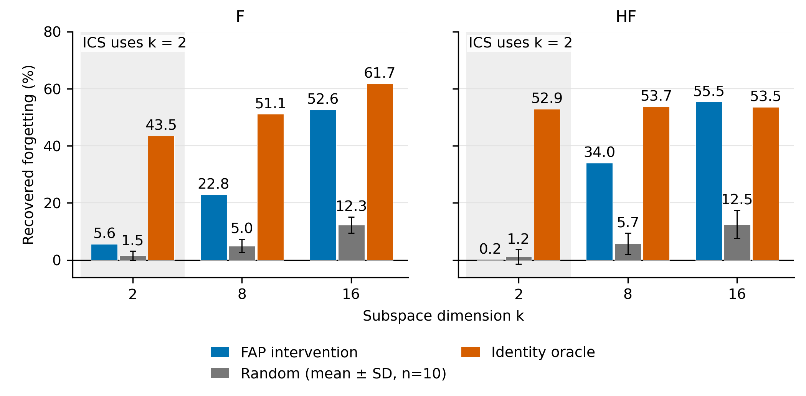
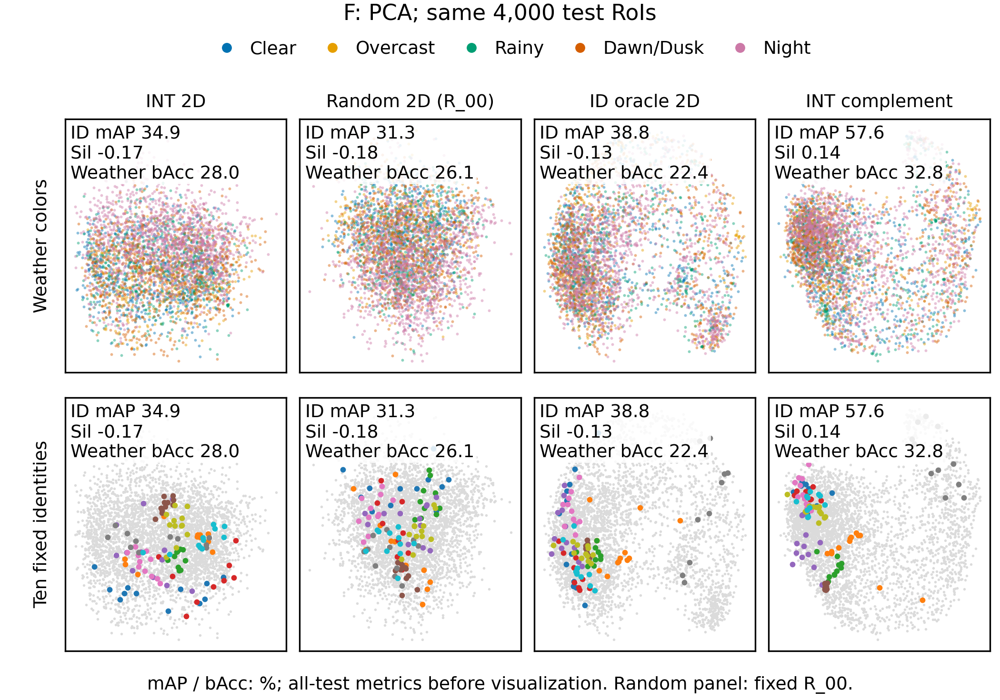
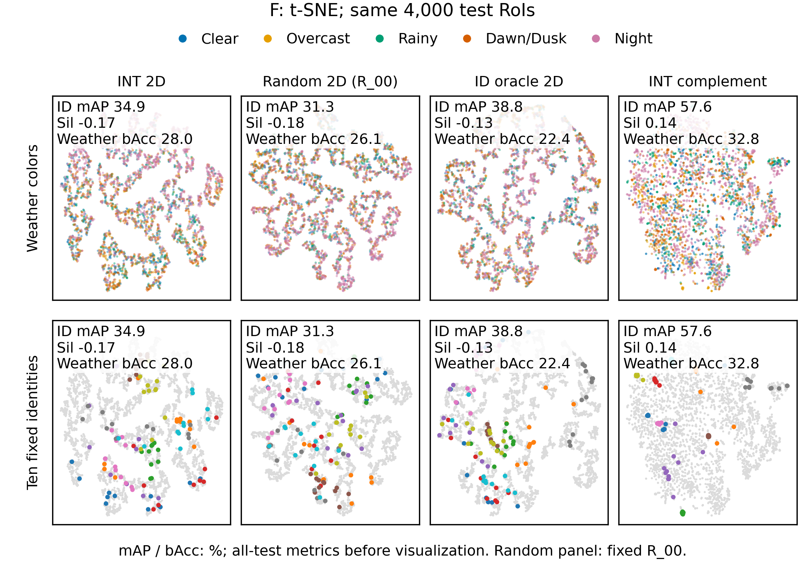
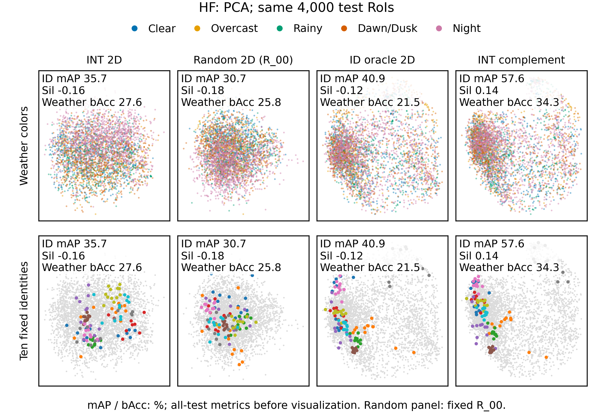
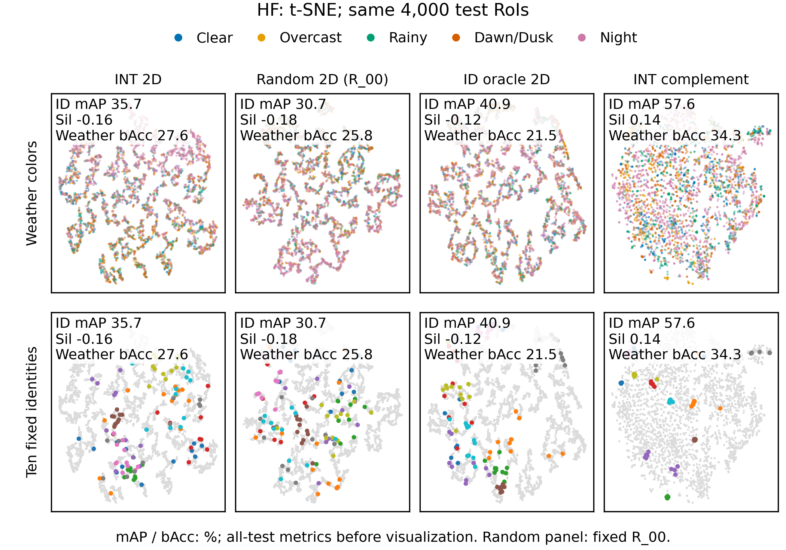

# ICS figures v2：CPU 离线重画与补充指标

模型：F、HF 的 stage4 特征。全部修改和产物位于本目录；不训练、不做 GPU 推理。

## 1. 漂移还原：统一使用 ratio of sums

`恢复比例 = 100 × 三旧域 forgetting_reduction 之和 / 三旧域 forgetting_proxy 之和`。

`剩余遗忘 = 100 × 三旧域 forgetting_restored 之和 / 3`。不再使用各域恢复比例的平均。这里的遗忘是跨阶段身份检索 mAP 损失的代理指标，不是实测跟踪 AvgF。

**自检全部 PASS：24/24 项。** 恢复比例最大绝对误差 0.046597，低于要求 0.1。F 未还原损失 1.922103 pp；HF 1.798300 pp。

| 模型 | 基底 | k | 恢复比例 (%) | 随机 SD | 随机 min/max | 剩余遗忘 (pp) | 未还原 (pp) |
|---|---|---:|---:|---:|---|---:|---:|
| F | FAP residual PCA | 2 | 5.632 | — | — | 1.813845 | 1.922103 |
| F | Random | 2 | 1.530 | 1.606 | [-0.393, 4.591] | 1.892698 | 1.922103 |
| F | Identity oracle | 2 | 43.537 | — | — | 1.085270 | 1.922103 |
| F | Label-free nuisance stage1 | 2 | 6.152 | — | — | 1.803850 | 1.922103 |
| F | FAP residual PCA | 8 | 22.847 | — | — | 1.482968 | 1.922103 |
| F | Random | 8 | 4.981 | 2.380 | [-0.006, 8.536] | 1.826367 | 1.922103 |
| F | Identity oracle | 8 | 51.102 | — | — | 0.939871 | 1.922103 |
| F | Label-free nuisance stage1 | 8 | 22.941 | — | — | 1.481147 | 1.922103 |
| F | FAP residual PCA | 16 | 52.620 | — | — | 0.910694 | 1.922103 |
| F | Random | 16 | 12.270 | 2.783 | [7.839, 16.331] | 1.686259 | 1.922103 |
| F | Identity oracle | 16 | 61.729 | — | — | 0.735600 | 1.922103 |
| F | Label-free nuisance stage1 | 16 | 50.352 | — | — | 0.954278 | 1.922103 |
| HF | FAP residual PCA | 2 | 0.159 | — | — | 1.795444 | 1.798300 |
| HF | Random | 2 | 1.167 | 2.501 | [-1.568, 4.836] | 1.777305 | 1.798300 |
| HF | Identity oracle | 2 | 52.918 | — | — | 0.846669 | 1.798300 |
| HF | Label-free nuisance stage1 | 2 | -1.324 | — | — | 1.822106 | 1.798300 |
| HF | FAP residual PCA | 8 | 34.011 | — | — | 1.186681 | 1.798300 |
| HF | Random | 8 | 5.707 | 3.761 | [-1.506, 10.743] | 1.695671 | 1.798300 |
| HF | Identity oracle | 8 | 53.740 | — | — | 0.831900 | 1.798300 |
| HF | Label-free nuisance stage1 | 8 | 38.763 | — | — | 1.101226 | 1.798300 |
| HF | FAP residual PCA | 16 | 55.496 | — | — | 0.800310 | 1.798300 |
| HF | Random | 16 | 12.489 | 4.859 | [4.361, 19.935] | 1.573704 | 1.798300 |
| HF | Identity oracle | 16 | 53.541 | — | — | 0.835469 | 1.798300 |
| HF | Label-free nuisance stage1 | 16 | 62.823 | — | — | 0.668546 | 1.798300 |

随机对照先对每个预定 replicate 计算上述 ratio of sums，再报告十个值的均值、总体 SD（ddof=0）和 min/max。它们是随机基底间变动，不是训练种子或置信区间。

来源：[A2_restoration.csv](../idapr/A/A2_restoration.csv)、[A2_random_replicates.csv](../idapr/A/A2_random_replicates.csv)。旧 [idAPR SUMMARY](../idapr/SUMMARY.md) 使用各域比例的平均，所以恢复百分比与本版不同；本版保留原 CSV，按用户指定新公式重算。

正文 A：[双栏](drift/drift_restoration_A_double.pdf) / [单栏](drift/drift_restoration_A_single.pdf)；补充 B：[双栏](drift/drift_restoration_B_double.pdf) / [单栏](drift/drift_restoration_B_single.pdf)；补充 C：[双栏](drift/drift_restoration_C_double.pdf) / [单栏](drift/drift_restoration_C_single.pdf)。

## 2. 全测试集的空间指标

数据完全复用未修改的 `evidence_cpu.load(model)`；基底直接读取已存 `.npy`。不重新估计基底，不对投影后的欧氏特征做归一化。天气探针只在 fit 视频拟合，测试使用所有 test RoI；同一身份标签只用于检索、聚集度评价和已冻结的 ID oracle。

轮廓系数：每视频仅保留出现 ≥3 次的身份，至少两个合格身份，使用全部合格 RoI 的精确 Euclidean silhouette，再按 RoI 数加权。方差比：每个非恒定测试视频的身份内 SSE / 总 SSE，按该视频全部 RoI 数加权；不对该项额外筛除短身份。

## F

| 空间 | ID mAP 欧氏 (%) | ID mAP 余弦 (%) | 身份轮廓系数 | 身份内部方差占比 ↓ | 天气 bAcc (%) | Night/Clear bAcc (%) |
|---|---:|---:|---:|---:|---:|---:|
| INT 2D | 34.929 | — | -0.1666 | 0.4527 | 28.020 | 69.285 |
| Random 2D (mean ± SD, n=10) | 30.631 ± 1.061 | — | -0.1809 ± 0.0122 | 0.5042 ± 0.0180 | 22.274 ± 2.027 | 56.112 ± 4.999 |
| ID oracle 2D | 38.777 | — | -0.1302 | 0.3910 | 22.377 | 54.470 |
| W oracle 2D | 37.892 | — | -0.1564 | 0.3490 | 29.803 | 76.382 |
| ICS bank 2D | 38.497 | — | -0.1471 | 0.4031 | 20.560 | 58.159 |
| INT 补空间 254D | 57.553 | 57.689 | 0.1363 | 0.4828 | 32.782 | 77.984 |
| Full 256D | 57.314 | 57.314 | 0.1364 | 0.4789 | 34.513 | 82.605 |

全部测试 RoI：18019；测试视频：77。轮廓系数实际使用 17410 个 RoI、76 个视频；方差占比使用 18019 个 RoI、77 个非恒定视频。检索沿用固定 4000 个 query，使用完整测试 RoI 构建对应 gallery。

## HF

| 空间 | ID mAP 欧氏 (%) | ID mAP 余弦 (%) | 身份轮廓系数 | 身份内部方差占比 ↓ | 天气 bAcc (%) | Night/Clear bAcc (%) |
|---|---:|---:|---:|---:|---:|---:|
| INT 2D | 35.733 | — | -0.1577 | 0.4593 | 27.622 | 68.045 |
| Random 2D (mean ± SD, n=10) | 30.525 ± 1.098 | — | -0.1794 ± 0.0137 | 0.4969 ± 0.0169 | 22.075 ± 2.055 | 55.990 ± 5.971 |
| ID oracle 2D | 40.944 | — | -0.1243 | 0.3495 | 21.532 | 52.952 |
| W oracle 2D | 37.614 | — | -0.1613 | 0.3663 | 31.220 | 75.480 |
| ICS bank 2D | 38.566 | — | -0.1484 | 0.4018 | 22.482 | 57.945 |
| INT 补空间 254D | 57.561 | 57.510 | 0.1360 | 0.4864 | 34.257 | 78.804 |
| Full 256D | 57.489 | 57.489 | 0.1368 | 0.4829 | 36.358 | 83.927 |

全部测试 RoI：18019；测试视频：77。轮廓系数实际使用 17410 个 RoI、76 个视频；方差占比使用 18019 个 RoI、77 个非恒定视频。检索沿用固定 4000 个 query，使用完整测试 RoI 构建对应 gallery。

## 3. 原表对齐自检

| 模型 | 空间 | 指标 | 新值 | 原表精确值 | 绝对差 | 结果 |
|---|---|---|---:|---:|---:|---|
| F | Full | id_mAP_cos | 57.313985006 | 57.313985006 | 0 | PASS |
| F | Full | weather_bacc | 34.512579043 | 34.512579043 | 0 | PASS |
| F | Complement | id_mAP_cos | 57.688940931 | 57.688940931 | 0 | PASS |
| F | Complement | weather_bacc | 32.782222785 | 32.782222785 | 0 | PASS |
| HF | Full | id_mAP_cos | 57.488597904 | 57.488597904 | 0 | PASS |
| HF | Full | weather_bacc | 36.357505608 | 36.357505608 | 0 | PASS |
| HF | Complement | id_mAP_cos | 57.510198686 | 57.510198686 | 0 | PASS |
| HF | Complement | weather_bacc | 34.256987075 | 34.256987075 | 0 | PASS |

对应原表：[ics_evidence Table 2b](../ics_evidence/SUMMARY.md#table-2b--delete-each-2d-subspace-β1-④)。Full 对应 Full 行，补空间对应 INT 删除行；余弦 mAP 另与原表 1 clean 行一致。

数值兼容说明：启动命令保持 OMP/OPENBLAS/MKL=4、CUDA_VISIBLE_DEVICES 为空。历史 [终端记录](../ics_evidence/logs/part1_F_terminal_transcript.txt) 明确使用 2 线程。未修改的 L-BFGS 天气探针在 4 线程下会改变少数预测；本版仅在历史加载/投影/分类探针兼容计算中临时使用 MKL=2，并恢复到 4；PCA、t-SNE、轮廓系数等保持 4 线程。诊断数据见 [probe_numerical_diagnostic.csv](logs/probe_numerical_diagnostic.csv)，首轮失败日志和 4 线程结果也完整保留。未放宽自检误差。

## 4. 预先指定的 P1–P4

### F

- **P1 FAIL**：INT 天气 bAcc 28.020281；Random 22.274395 ± 2.026997；严格阈值 mean + 3SD = 28.355386。
- **P2 PASS**：欧氏身份 mAP，INT 34.929303、ID oracle 38.777485；轮廓系数，INT -0.166575、ID oracle -0.130201。要求两项均严格低于 ID oracle。
- **P3 id_mAP_euc：相对随机为“高于”**。INT 34.929303；Random 30.630741 ± 1.061233；预定 ±2SD 区间 [28.508275, 32.753208]。
- **P3 silhouette：相对随机为“相当（在 ±2SD 内）”**。INT -0.166575；Random -0.180875 ± 0.012185；预定 ±2SD 区间 [-0.205245, -0.156504]。
- **P4 PASS**：补空间余弦 mAP 57.688941 / Full 57.313985 = 100.654214%，要求 ≥98%。

### HF

- **P1 FAIL**：INT 天气 bAcc 27.621636；Random 22.075242 ± 2.054644；严格阈值 mean + 3SD = 28.239173。
- **P2 PASS**：欧氏身份 mAP，INT 35.732978、ID oracle 40.943898；轮廓系数，INT -0.157665、ID oracle -0.124314。要求两项均严格低于 ID oracle。
- **P3 id_mAP_euc：相对随机为“高于”**。INT 35.732978；Random 30.525330 ± 1.098096；预定 ±2SD 区间 [28.329139, 32.721522]。
- **P3 silhouette：相对随机为“相当（在 ±2SD 内）”**。INT -0.157665；Random -0.179361 ± 0.013674；预定 ±2SD 区间 [-0.206709, -0.152014]。
- **P4 PASS**：补空间余弦 mAP 57.510199 / Full 57.488598 = 100.037574%，要求 ≥98%。

P3 的“相当”仅指用户预设的十个随机基底均值 ±2SD 描述性区间，不是正式等效性检验；P1 的 3SD 阈值也不解释为独立显著性检验。

## 5. PCA 与 t-SNE 的图像观察

t-SNE 更清楚地展示了补空间中的局部身份聚集：两模型的补空间下排中，高亮同一身份的点比 INT 或 Random 列更集中。PCA 只保留最高方差的两个方向，补空间下排仍有较多身份重叠。该观察对应原空间中补空间约 57.5% 的欧氏检索 mAP 和正的轮廓系数。

PCA 对原本只有两维的 INT、Random、ID 空间只是旋转，更适合直接观察这些平面的原始几何结构。INT 和 Random 的天气颜色均大量混合，两种可视化都没有展示清晰的五域分离。INT 天气 bAcc 高于随机均值，但 F/HF 均未达到预定 mean+3SD 的 P1 阈值。

t-SNE 在 INT、Random 和 ID 三个二维输入上都产生了岛状或曲线状结构，不能将这些结构本身当作天气可分的证据。图上的身份聚集必须结合降维前的全测试集指标判断。

结论应写成：去掉 INT 两维基本保留身份检索能力；INT 含部分天气信息，也仍含身份信息。P2 支持 INT 的身份信息弱于身份 oracle；P3 显示 INT 身份检索高于随机均值+2SD，身份轮廓系数位于随机均值±2SD 内。现有结果不足以把 INT 称为只承载天气的专用子空间。

漂移 A/B/C 均使用相同配色和共享纵轴，明确显示 k=2、8、16，随机误差棒包含十个预定基底。k=2 的 FAP 恢复比例为 F 5.6%、HF 0.2%，身份 oracle 为 43.5%、52.9%；FAP 在 k=8/16 时恢复比例明显增大。此处衡量的是跨阶段身份检索遗忘代理，不是跟踪 AvgF。

### F

### HF

图中所有列使用同一种降维方法；数值标注来自降维前的全测试集。每模型的两套图复用原 `quadrant_indices` 和 `highlighted_identities`，Random 固定 R_00；表格 Random 使用全部十个基底。t-SNE 的簇形状不替代原空间的欧氏聚集度和检索量化指标。

## 6. 复现与产物

见 [README.txt](README.txt)、[scripts/run_all.sh](scripts/run_all.sh)。脚本仅 import 历史模块，未改动历史文件。原始特征和源码哈希见 `quadrant/metrics_protocol_{F,HF}.json`；图坐标 CSV、固定采样清单、全量逐基底指标和运行日志均随本目录交付。
