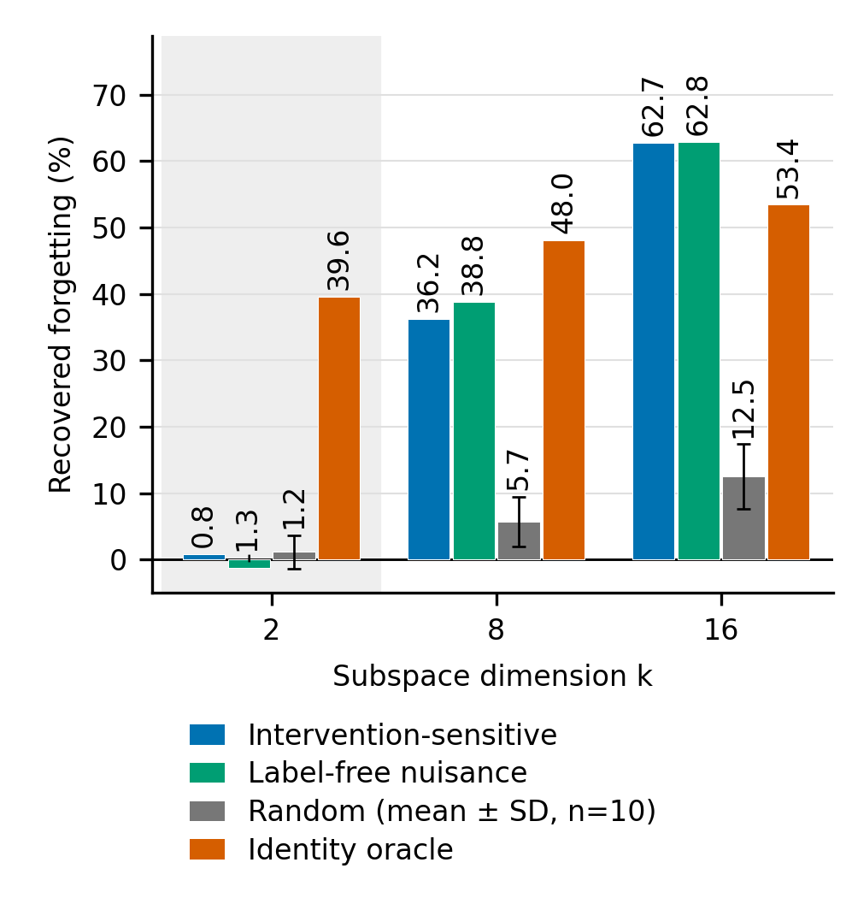
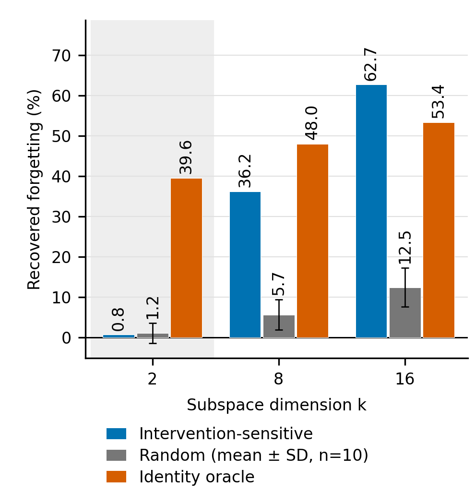

# HF 原生 ICS 图表 v3

纯 CPU 离线重算；只使用 HF 模型，不训练、不抽取新特征。全部新增文件在本目录。

## 1. 输入与修正范围

已执行 `git pull --ff-only origin main`，起点为 `6375023aef7987a66e2d75809f85c9a551f8afa2`。

HF 特征根目录从 [idapr/inputs.txt](../idapr/inputs.txt) 的 `HF_feat_root` 读取：`/data1/liuyeqiang/damot_ics_followup_20261029/results/feats`。HF_stage1_e5 五域的 `feat_clean` 和 `feat_fap` 均存在、维数为 256、数值有限；类别均为 car。各 NPZ 的路径、形状和 SHA-256 见 [input_manifest.json](input_manifest.json)。

旧 [idapr_offline.py](../idapr/source/tools/analysis/idapr_offline.py) 的 `run_model` 对 F、HF 共用 `F_stage1_e5` 来估计 FAP residual PCA 与 Identity oracle。本版复用同一 `oracle_bases` 函数，将 reference 改为 **HF_stage1_e5**，只发布它的 FAP 与身份基底。这两个基底只在 HF stage1 fit 视频上估计；推理/训练实现未改动，也没有读取 F 特征。

Label-free nuisance 沿用 A2 中已有的 **HF stage1** 行；Random 沿用 HF 的全部十个预定 replicate。任务 3 单独使用 HF stage4 的 INT 与无标签身份基底，不能把它们与 stage1 漂移基底混称。

fit/test 视频划分与原 HF 完全一致：fit 15820 个 RoI、71 个视频，test 18019 个 RoI、77 个视频；视频不交叉。检索保持 gap=4、window=30、max_q=4000、seed=0，query_stage=4，gallery_stage=1/2/3，匹配旧域 Overcast/Rainy/Dawn-Dusk。

## 2. 漂移还原结果

`恢复比例 (%) = 100 × Σ forgetting_reduction / Σ forgetting_proxy`，对三个旧域求和。

`剩余遗忘 (pp) = 100 × Σ forgetting_restored / 3`。**未还原遗忘为 1.798299953 pp**，通过 1.798 pp 的自检。这里的遗忘是跨阶段身份检索 mAP 损失的代理，不能当作跟踪 AvgF。

| k | Intervention-sensitive (%) | Label-free nuisance (%) | Random mean ± SD (%) | Identity oracle (%) |
|---:|---:|---:|---:|---:|
| 2 | 0.769 | -1.324 | 1.167 ± 2.501 | 39.605 |
| 8 | 36.243 | 38.763 | 5.707 ± 3.761 | 48.043 |
| 16 | 62.704 | 62.823 | 12.489 ± 4.859 | 53.406 |

随机 SD 使用十个 replicate 各自的 ratio of sums，再计算总体 SD（ddof=0）；它描述基底间变动，不是训练种子置信区间。

| k | 基底 | 恢复比例 (%) | 随机 SD | 随机 min/max (%) | 剩余遗忘 (pp) |
|---:|---|---:|---:|---|---:|
| 2 | Intervention-sensitive | 0.768968 | — | — | 1.784471603 |
| 2 | Label-free nuisance | -1.323832 | — | — | 1.822106414 |
| 2 | Random | 1.167474 | 2.501270 | [-1.568341, 4.836009] | 1.777305271 |
| 2 | Identity oracle | 39.604985 | — | — | 1.086083524 |
| 8 | Intervention-sensitive | 36.243057 | — | — | 1.146541081 |
| 8 | Label-free nuisance | 38.762935 | — | — | 1.101226120 |
| 8 | Random | 5.707014 | 3.760882 | [-1.506473, 10.743098] | 1.695670729 |
| 8 | Identity oracle | 48.042824 | — | — | 0.934345873 |
| 16 | Intervention-sensitive | 62.704037 | — | — | 0.670693294 |
| 16 | Label-free nuisance | 62.823421 | — | — | 0.668546410 |
| 16 | Random | 12.489367 | 4.859111 | [4.360770, 19.934784] | 1.573703681 |
| 16 | Identity oracle | 53.405503 | — | — | 0.837908817 |

逐域恢复比例如下。汇总列使用上面的 ratio of sums，并非下面三个百分比的平均。

| k | 基底 | Overcast (%) | Rainy (%) | Dawn/Dusk (%) |
|---:|---|---:|---:|---:|
| 2 | Intervention-sensitive | -0.353149 | -4.024133 | 11.550777 |
| 2 | Label-free nuisance | -3.338943 | -2.470327 | 7.864827 |
| 2 | Random | 0.409769 | 1.360547 | 3.771429 |
| 2 | Identity oracle | 28.385229 | 17.421448 | 112.309828 |
| 8 | Intervention-sensitive | 38.177293 | 8.158996 | 67.217693 |
| 8 | Label-free nuisance | 39.695701 | 12.427293 | 71.143168 |
| 8 | Random | 4.704854 | 5.128615 | 10.287948 |
| 8 | Identity oracle | 54.781753 | 10.243863 | 74.082816 |
| 16 | Intervention-sensitive | 60.506597 | 31.546382 | 113.504284 |
| 16 | Label-free nuisance | 59.541279 | 32.198405 | 117.001996 |
| 16 | Random | 12.314544 | 12.739103 | 12.810381 |
| 16 | Identity oracle | 55.238145 | 26.832691 | 82.703924 |

完整的原始 mAP、逐域遗忘、汇总、逐域随机 replicate、随机汇总和 SD 均在 [drift_restoration_HF_native.csv](drift_restoration_HF_native.csv)（168 行数据）；其中 summary 行的三个原始 forgetting 字段是三域之和，mAP 字段留空；domain 行为该域本身。所有 mAP 原始字段为 0–1，`*_pct` 为百分数，`*_pp` 为百分点。

### 与旧 F 参考基底结果的差别

两版均使用相同 ratio-of-sums 口径，唯一区别是估计基底的参考模型。

| k | 基底 | 旧 F_stage1 参考 (%) | 本版 HF_stage1 参考 (%) | 差值 (pp) |
|---:|---|---:|---:|---:|
| 2 | Intervention-sensitive | 0.158832 | 0.768968 | +0.610136 |
| 2 | Identity oracle | 52.918366 | 39.604985 | -13.313381 |
| 8 | Intervention-sensitive | 34.010951 | 36.243057 | +2.232106 |
| 8 | Identity oracle | 53.739640 | 48.042824 | -5.696816 |
| 16 | Intervention-sensitive | 55.496285 | 62.704037 | +7.207751 |
| 16 | Identity oracle | 53.541171 | 53.405503 | -0.135668 |

HF 原生 k=2 干预方向恢复 0.769%，随机为 1.167 ± 2.501%，身份 oracle 为 39.605%。这里只能描述干预前两维恢复很少、身份方向恢复更多；没有据此做随机基底间的显著性或等效性检验。扩展到 k=8/16 后干预方向恢复 36.243% / 62.704%，不能把高维干预空间也说成不承载遗忘。

### 自检

| 检查 | 域 | k | 实际 | 参考 | 绝对误差 | 结果 |
|---|---|---:|---:|---:|---:|---|
| A2_baseline_mAP_same | overcast |  | 0.613007016667 | 0.613007016667 | 0 | PASS |
| A2_baseline_mAP_cross | overcast |  | 0.579799496549 | 0.579799496549 | 0 | PASS |
| A2_baseline_forgetting_proxy | overcast |  | 0.033207520118 | 0.033207520118 | 0 | PASS |
| A2_baseline_mAP_same | rainy |  | 0.631628101412 | 0.631628101412 | 0 | PASS |
| A2_baseline_mAP_cross | rainy |  | 0.619662193196 | 0.619662193196 | 0 | PASS |
| A2_baseline_forgetting_proxy | rainy |  | 0.0119659082155 | 0.0119659082155 | 0 | PASS |
| A2_baseline_mAP_same | dawn_dusk |  | 0.551352261698 | 0.551352261698 | 0 | PASS |
| A2_baseline_mAP_cross | dawn_dusk |  | 0.542576691445 | 0.542576691445 | 0 | PASS |
| A2_baseline_forgetting_proxy | dawn_dusk |  | 0.00877557025286 | 0.00877557025286 | 0 | PASS |
| random_recovery_pct | three_old_domains | 2 | 1.16747383995 | 1.2 | 0.0325 | PASS |
| random_recovery_pct | three_old_domains | 8 | 5.70701366432 | 5.7 | 0.00701 | PASS |
| random_recovery_pct | three_old_domains | 16 | 12.4893665111 | 12.5 | 0.0106 | PASS |
| none_forgetting_pp | three_old_domains |  | 1.79829995288 | 1.798 | 0.0003 | PASS |

**13/13 项通过**。九项逐域 baseline 与原 A2 对齐，最大允许误差 1e-9；随机均值与 1.2 / 5.7 / 12.5 的误差均小于 0.1；未还原遗忘误差小于 0.001 pp。

两图均为单个 HF 子图，宽 3.3 英寸，字体至少 8pt，PNG 300dpi，PDF 同尺寸；k=2 组只加浅灰底，不加文字。图例置底。

## 3. 固定二十个 RoI 截图

严格复用 [plot_C_crops.csv](../ics_evidence/part1/HF/plot_C_crops.csv) 的二十行、顺序和浮点 bbox，布局仍为 2×10，不重新选点。去掉总标题；每个小图只有天气和投影坐标。原图解析路径、crop 尺寸、标签及文件哈希见 [crop_manifest.csv](crop_manifest.csv) 和 [crop_protocol.json](crop_protocol.json)。

## 4. 表 S1：直接核对保存的 INT_00

测试数据为 HF stage4 的全部 18,019 个 car RoI。真实跨天气偏移按 A1 定义：四个目标天气均值相对 Clear 的差，乘 sqrt(min(n_target,n_clear))；身份能量使用未修改的 `p.identity_rows`（视频内身份均值差，至少三次观测）。两项均计算 `sum((rows @ E)^2) / (sum(rows^2)+EPS)`，不是逐样本比例的平均。

无标签身份基底按 A1 的 `label_free_bases` 在 HF stage4 fit car RoI 上重新估计，视图为 FAP/photo/student，eps_ratio=0.1；只向估计器提供图像成员关系和配对特征。它与任务 1 的“有身份标签的 stage1 oracle”不同。

| 基底 | 跨天气能量 (%) | 身份能量 (%) | 对应 A1 | 天气差值 (pp) | 身份差值 (pp) | 与 A1 nuisance 的两个主角度 (°) |
|---|---:|---:|---|---:|---:|---|
| INT_00 | 39.388027454 | 11.112478751 | HF/4 nuisance k=2 | -1.11e-14 | -1.39e-15 | 4.20834255323e-16, 2.5008468992e-14 |
| Label-free identity | 2.553181984 | 13.344943363 | HF/4 identity k=2 | -3.47e-15 | -5.55e-15 | 82.5984101547, 88.4548926384 |
| A1 nuisance saved | 39.388027454 | 11.112478751 | HF/4 nuisance k=2 | 0 | 0 | 4.20834255323e-16, 2.5008468992e-14 |
| A1 identity saved | 2.553181984 | 13.344943363 | HF/4 identity k=2 | 0 | 0 | 82.5984101547, 88.4548926384 |

**确认一致**：直接使用 INT_00 的结果等于（按两位小数） 39.39% / 11.11%；无标签身份基底等于（按两位小数） 2.55% / 13.34%。完整精度和每项差值见 [S1_energy_check.csv](S1_energy_check.csv)。所有解释以本次直接测量的 INT_00 为准。

INT 与 A1 nuisance 本次在数值精度内相同；约 1e-14° 的角度和约 1e-14 pp 的差值属于数值精度。表 S1 可以引用该 INT 直接测量值。

## 5. 复现与校验

命令与依赖见 [README.txt](README.txt)，完整顺序见 [scripts/run_all.sh](scripts/run_all.sh)。运行日志在 [logs/](logs/)。输入/源码哈希在 [input_manifest.json](input_manifest.json)，检索任务哈希在 [retrieval_protocol.json](retrieval_protocol.json)，全包校验结果在 [validation.json](validation.json)。

所有命令使用 OMP_NUM_THREADS=4、OPENBLAS_NUM_THREADS=4、MKL_NUM_THREADS=4、CUDA_VISIBLE_DEVICES 为空；没有临时降低 MKL 线程数。仅导入历史分析模块，不修改历史目录。
