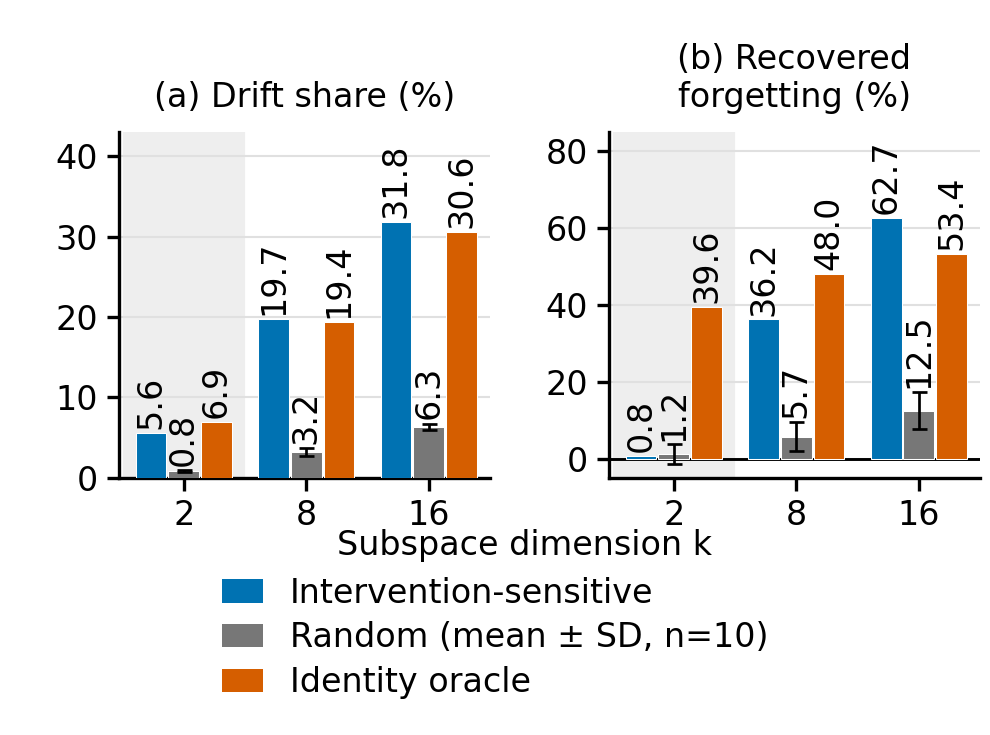
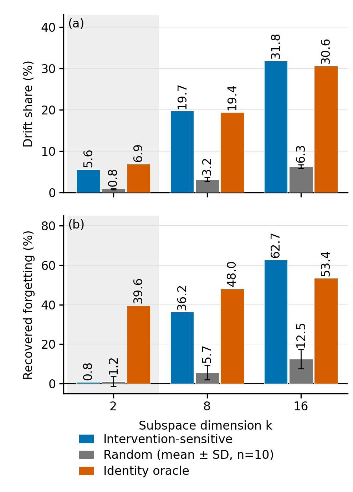
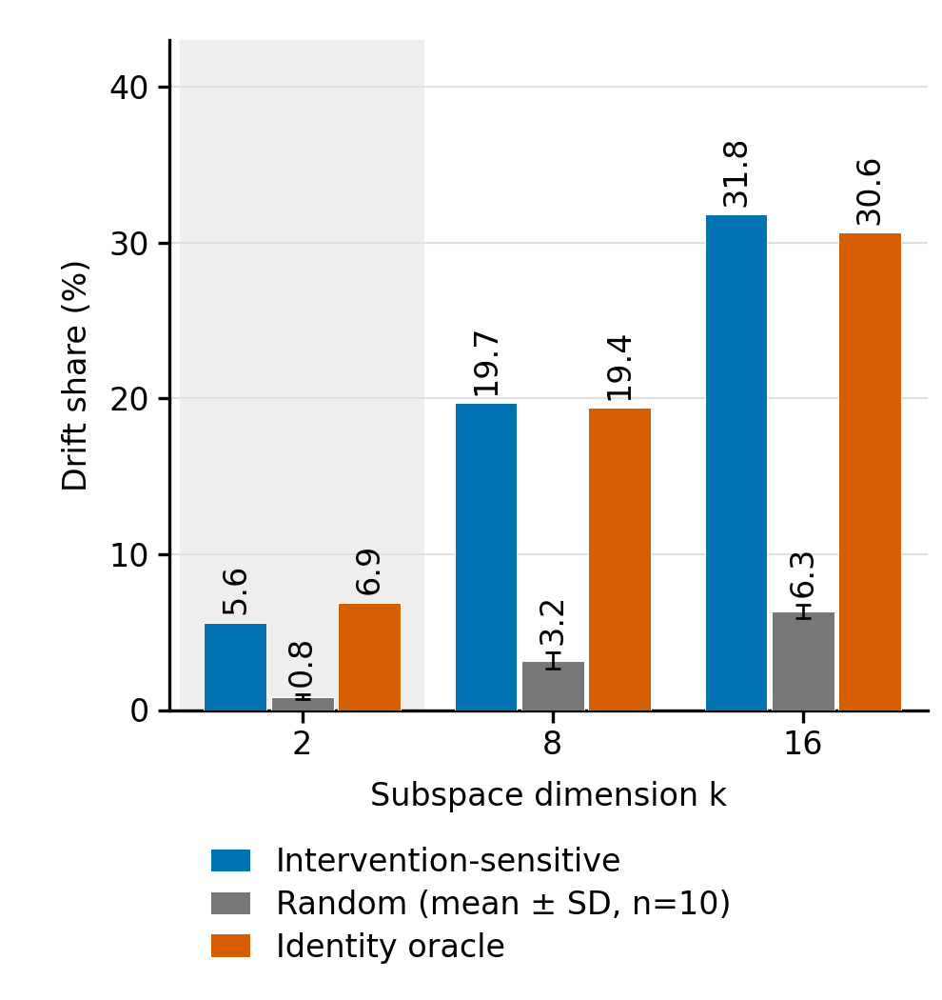

# HF 漂移能量与遗忘恢复：单栏双图

新增 Drift share (%) 柱状图，与已有 Recovered forgetting (%) 使用相同基底、颜色和 k=2/8/16。直接读取已有 CSV；不重新估计基底、不重新计算实验指标、不使用 GPU。

推荐使用 **左右紧凑版**：宽 3.3 英寸、高 2.45 英寸，两个面板共用一个图例，所有字号至少 8pt。它比原来一张 3.3×3.5 英寸的单图更适合节省单栏空间。

[PDF 矢量版](drift_pair_HF_horizontal.pdf) · [PNG 300dpi](drift_pair_HF_horizontal.png)

若版面允许更高的图，可用 **上下版**（3.3×4.6 英寸）：

[上下版 PDF](drift_pair_HF_vertical.pdf) · [上下版 PNG](drift_pair_HF_vertical.png)

单独的新增柱状图（与旧图同为 3.3×3.5 英寸）：

[Drift share PDF](drift_share_HF_3bars.pdf) · [Drift share PNG](drift_share_HF_3bars.png)

## 对应数据

每格为“漂移能量占比 % / 恢复遗忘 %”；均为实测数据。Random 为十个固定随机基底的均值，图中误差棒是对应指标的总体 SD（ddof=0）。

| 基底 | k=2 | k=8 | k=16 |
|---|---:|---:|---:|
| Intervention-sensitive | 5.613 / 0.769 | 19.731 / 36.243 | 31.826 / 62.704 |
| Random | 0.846 / 1.167 | 3.173 / 5.707 | 6.336 / 12.489 |
| Identity oracle | 6.897 / 39.605 | 19.425 / 48.043 | 30.631 / 53.406 |

这对图支持的具体观察是：k=2 时，两种数据估计基底包含 5.61% 和 6.90% 的漂移能量，但还原它们分别恢复 0.77% 和 39.60% 的检索遗忘代理损失。k=8/16 的干预方向也显示了较高恢复比例，图中完整保留。

左图的 Drift share 是逐 RoI 的跨阶段特征漂移能量，统计同一组 8,117 对测试 car RoI：Overcast stage1、Rainy stage2、Dawn/Dusk stage3 分别相对 stage4。它与 A1/S1 的天气域均值偏移能量不同。右图是跨阶段身份检索 mAP 损失的恢复比例，不是跟踪 AvgF。

两个面板使用不同的纵轴范围，分别标明单位；相同颜色只用于对应相同基底。k=2 组保留浅灰底，不加文字。

数据来源：[energy_summary.csv](../ics_figs_v3_energy/energy_summary.csv)；恢复比例及其 SD 与 [v3 drift_summary.csv](../ics_figs_v3/drift_summary.csv) 逐项核对。绘图数据另存 [plot_data.csv](plot_data.csv)。

复现见 [README.txt](README.txt)，建议的论文插图代码见 [figure.tex](figure.tex)。原目录全部保持只读；源 CSV 哈希、尺寸与字体检查见 [validation.json](validation.json)，人工视觉检查见 [visual_review.json](visual_review.json)。
