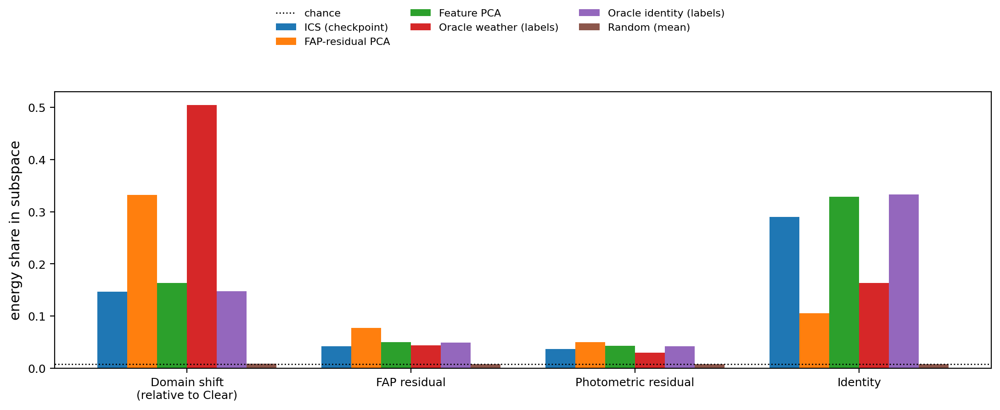

# ICS 子空间探针：BDD 冻结检查点结果

本次完成 P1–P5：复用 `F_stage1–4_e5`，在 Clear holdout、Overcast、Rainy、Dawn/Dusk、Night 五个域提取 car RoI 嵌入。每阶段得到 **33,839 个 RoI**，全部 20 个“阶段×域”文件通过数值及样本一致性校验。DAMOT 权重保持冻结；天气线性分类器仅在按视频划分的 fit 部分拟合。

**本次结果不支持把当前 ICS 解释为“天气专用、近乎不含身份信息”的子空间。** 这是对表示解释的检验，不是否定已有跟踪精度结果。当前检查点的估计方式是 `proto_shrinkage_cov_ema`，即类中心化特征协方差的主要方向。

## 查看结果

- [全部图：7 页 PDF](analysis_F_stage4_e5/figs/all_figures.pdf)
- [完整中文结果](RESULTS.txt)、[结论与解释边界](INTERPRETATION.txt)、[图注](FIGURE_CAPTIONS.txt)
- [完整 CSV](analysis_F_stage4_e5/csv/)、[三张 LaTeX 表](analysis_F_stage4_e5/tables/)、[完整数值 JSON](analysis_F_stage4_e5/summary.json)
- [图表可读性检查](readability_review.json)、[交付验证](delivery_validation.json)

## 主要发现

| 探针 | 实测结果 |
|---|---|
| P1 跨域偏移能量 | 相对 Clear 的均值偏移有 **14.64%** 落在 ICS 内，随机方向期望为 **0.78125%** |
| P1 身份差异能量 | ICS 为 **28.96%**；Weather/Identity = **0.506** |
| P1 FAP 残差能量 | ICS 为 **4.18%** |
| P2 天气分类 | 只用 ICS 两维为 **20.56%**，随机准确率 **20%**；补空间 **34.67%**，全空间 **34.51%** |
| P2 身份检索 | ICS 两维 mAP **33.50%**，随机两维 **28.58%**；补空间 **57.73%**，全空间 **57.31%** |
| P3 完全收缩 ICS | 天气准确率 **34.52% → 34.92%**，没有下降；身份 mAP **57.31% → 57.73%** |
| P3 身份负对照 | 收缩身份 oracle 两维后 mAP **57.31% → 59.35%**，没有得到预期负对照效应 |
| P4 剂量响应 | 子空间内变化随扰动强度增加，但仅承载约 **3.3–4.3%** 的变化能量，大部分变化在补空间 |
| P5 阶段演化 | 刚适应域成为行内最大值的情况仅 **2/4**；完成 Night 后 Night 占比 **8.01%**，低于 Dawn/Dusk 的 **28.58%** |

BDD 的域差异还包含场景、相机和车辆组成变化，不能等同于纯天气的配对差异。P3 是离线特征干预，每档重新拟合天气分类器，未重新测量跟踪 HOTA；负对照未达到预设效果，因此不能把身份检索保持直接当作强因果证据。P5 使用全部抽样视频，P1–P4 的评估统计使用 test 视频。

## 数据、验证与来源

抽样规则为每域最多 40 个视频、每视频前 30 个抽样帧、步长 2，每帧最多 40 个 car 框，最小框边长 16 像素。Clear 使用独立 45 视频 holdout 中的 40 视频；四个目标域来自原适应池。计划抽样 148 视频、4,440 帧，筛选后 4,331 帧含保留的 RoI。fit/test RoI 数为 15,820/18,019；具体域与身份数量见 [sampling_counts.csv](analysis_F_stage4_e5/csv/sampling_counts.csv)。

- 最终脚本的合成数据自检 **7/7 PASS**：[日志](logs/selftest_final_full.log)。
- 16 种视图的串行与多进程提取结果最大差值均为 **0**：[比对](prefetch_parity.json)。
- 全部 20 个特征文件通过校验，跨阶段视频、ID、帧号、类别与框完全一致：[验证记录](feature_validation.json)。
- 六组图共七页，含 40 个自动选择的原始 RoI 截图；全部已逐张检查。小框的像素化来自原图分辨率。
- [运行清单](run_manifest.json)、[软件环境](environment.json)、[数据来源](data_manifest.json)、[逐阶段/逐域 meta](feats/)、[加载配置](configs/)和[日志](logs/)保留复核信息与机器上的运行路径。
- [交付文件校验清单](delivery_file_manifest.json)保存原始交付文件的字节数和 SHA256。此 README 与本目录的 `.gitignore` 是发布时补充的入口文件。

原始 `.npz` 特征保留在执行服务器，未纳入本 Git 目录；模型权重与图像也继续使用原有缓存。

## 脚本与复现

代码位于仓库的 [运行说明](../../tools/analysis/ICS_PROBE_README.md)、[特征提取](../../tools/analysis/ics_probe_extract.py)、[离线分析](../../tools/analysis/ics_probe_analyze.py)、[自检](../../tools/analysis/ics_probe_selftest.py)和[BDD 启动脚本](../../tools/analysis/run_ics_probe_bdd.sh)。[修正补丁](ics_probe_corrected.patch)及[原始输入](inputs/)一并保留。

运行依赖完整 rebuttal 代码快照、检查点、标注与图像路径；配置中的本机路径需要按执行环境设置。`run_verified_probe.py` 和 `create_delivery.py` 是本次本地控制与打包记录，实际命令见 `progress.json` 和日志。

修订包括：修复模型 `eval()` 返回空值的链式调用；检查全部抽样路径；固定剂量档位的随机掩码；P1 使用 Clear 参考；P4 在同批剂量帧中按视频区分 COCO image id；增加保持视图结果完全一致的 CPU 多进程预取；改善图例、箭头比例与截图标注。

R2 配置已校验为仅更换 ICS 估计方式，并保留 `min_samples=96`，**本轮未训练 R2**。可选 VKITTI2 P6 **未执行**。成对残差还包含几何增强差异；跨模型 bank 比较需要检查或对齐各自嵌入坐标。
